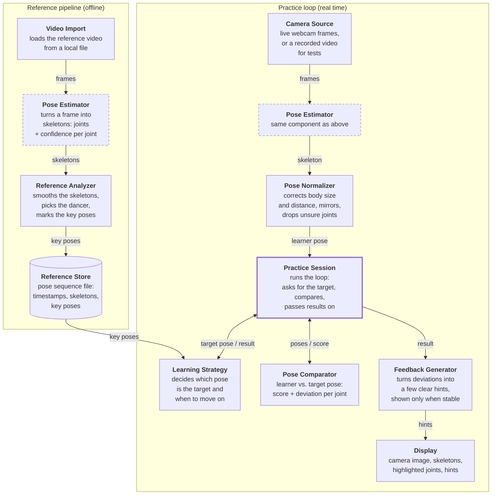

# Dance Teacher – Architecture

Dance Teacher helps a learner practise a short dance routine alone. It compares
the learner's live pose from the webcam with a reference video and shows what to
correct. Everything runs locally on one laptop: no server, no cloud, camera
images never leave the machine.

**First prototype assumes**

- one person in the reference video, one learner in front of the camera
- a fixed camera; the learner faces it with the full body in frame
- a pretrained pose-estimation library (e.g. MediaPipe Pose or MoveNet); we don't train models

**Out of scope:** model training, partner dancing, multiple or back-facing
cameras, full technique assessment.

## Overview

There are two pipelines. The **reference pipeline** runs once per video and
turns it into key poses. The **practice loop** runs for every camera frame: it
compares the learner's pose with the current target pose and turns the result
into feedback. The pipelines only meet at the pose sequence file. The Pose
Estimator is the only component both use (dashed boxes). The Practice Session
(thick box) controls the loop.



## Components

| Component | Pipeline | What it does | First prototype |
|---|---|---|---|
| Video Import | Reference | Loads a reference video from a local file. | Yes, file only |
| Pose Estimator | Both | Turns one frame into skeletons (2D joints + confidence per joint). Wraps the pretrained library behind our own interface and always returns a list, one skeleton per person. | Yes |
| Reference Analyzer | Reference | Smooths and normalizes the skeleton sequence, picks the dancer and marks key poses: moments where the movement briefly holds or changes direction. | Yes, dancer = the only person |
| Reference Store | Reference | Saves a pose sequence file next to the video: timestamps, skeletons per person, key poses. The only link between the two pipelines. | Yes |
| Camera Source | Practice | Delivers live webcam frames. A replay adapter can feed a recorded video instead, which makes tests repeatable. | Yes, webcam + replay |
| Pose Normalizer | Practice | Corrects for body size and distance, mirrors the learner and drops low-confidence joints, so tracking noise isn't reported as a mistake. | Yes |
| Pose Comparator | Practice | Compares learner and target pose (e.g. joint angles per limb). Returns an overall score and a deviation per joint. Pure calculation, no I/O. | Yes |
| Practice Session | Practice | Runs the loop for every frame: asks the strategy for the current target, calls the comparator, hands the result back to the strategy and on to feedback. | Yes |
| Learning Strategy | Practice | Decides which pose is the target right now and when to move on. Interchangeable, see below. | Pose by Pose only |
| Feedback Generator | Practice | Turns deviations into a few clear hints, e.g. "raise your left arm". Shows a hint only once it is stable over several frames, so nothing flickers. | Score + highlighted joints |
| Display | Practice | Shows the camera image with the learner's skeleton, the target pose, coloured joints, hints and progress. | Yes |

## Learning strategies (Strategy pattern)

The Practice Session only talks to one interface. Each way of teaching is its
own class behind it, so adding a strategy changes no other component.

```ts
interface LearningStrategy {
  start(reference: PoseSequence)
  currentTarget(): TargetPose         // the pose the learner should match now
  playback(): PlaybackState           // what the Display shows: still pose, speed, loop range
  onResult(result: ComparisonResult)  // may advance, repeat or slow down
  isFinished(): boolean
}
```

**Pose by Pose** (first prototype)

1. The Display shows the first key pose next to the learner's live skeleton.
2. The learner adjusts until the score stays above a threshold for a short hold time.
3. Only then does the next key pose appear. After the last one, the routine is done.

Why this one first: there is no timing pressure, so the comparator only needs
pose similarity. The hardest problem, aligning two movements in time, waits,
but the full loop from camera to feedback is still built end to end.

**Later**

| Strategy | How it works | Needs beyond the prototype |
|---|---|---|
| Slow Motion | The reference plays slowed down, the learner dances along. | Comparator that tolerates small time offsets |
| Loop Segment | The learner picks a section; it repeats until the score passes a threshold. | Section selection in the Display |
| Dance Along | Full speed; feedback separates "too late" from "wrong pose". | Time-aligning comparator |
| Adaptive Teacher | Switches between the others, e.g. slows down after repeated misses. | A composite strategy; nothing else changes |

In the prototype the strategy is fixed. Later the learner picks one when
starting a session, and the Adaptive Teacher can switch during it.

## First prototype and later extensions

The first prototype is a vertical slice: one reference video in, one fixed
strategy, live feedback out, all on one laptop. It contains:

- reference video import from a file, single dancer
- Pose Estimator with one library adapter, used by both pipelines
- key-pose detection in the Reference Analyzer
- the live loop: camera, normalization, comparison, feedback, display
- Pose by Pose as the only strategy, not selectable
- feedback as a match score plus highlighted joints
- a replay adapter for the camera, for repeatable tests

Everything below is prepared in the architecture but not built yet:

| Extension | Where it plugs in | Why no redesign is needed |
|---|---|---|
| Selectable strategies | Practice Session + selection screen | Strategies already sit behind one interface |
| Slow Motion, Loop Segment, Dance Along | New strategy classes | Dance Along also needs a time-aligning comparator, which replaces the current one |
| Adaptive Teacher | New composite strategy | Results already flow back through `onResult` |
| Several people in the reference video | "Select dancer" step in the Reference Analyzer | Pose Estimator and pose sequence file already hold one skeleton per person |
| Recording a reference in the app | New Video Import source | Everything downstream only sees frames |
| Another pose model or 3D joints | New Pose Estimator adapter | The pose sequence file has a 2D/3D field |
| Text hints and a session summary | Feedback Generator, new summary view | The comparator already returns a deviation per joint |
| Progress across sessions | New component that reads session results | Sits outside the real-time loop |

## Design decisions

Each decision keeps a likely change cheap.

| # | Decision | Why | Consequence |
|---|---|---|---|
| D1 | Everything runs locally on one laptop | Lowest latency, images stay private, no infrastructure | Speed is limited by the laptop; we measure the Pose Estimator's frame rate and latency in week 1 |
| D2 | One Pose Estimator behind our own interface, used by both pipelines | Reference and learner skeletons come from the same model; the library can be swapped | An adapter maps the library's joints to our skeleton format |
| D3 | The pose sequence file is the only link between the pipelines | Reference analysis and practice can change independently | The format is versioned and carries person ID and 2D/3D from day one |
| D4 | Learning strategies use the Strategy pattern | New teaching methods without touching the loop | The interface must also fit strategies we haven't built yet |
| D5 | The prototype assumes one person, the data model allows many | Small first scope, no redesign later | The analyzer takes the only skeleton until dancer selection exists |
| D6 | The Pose Comparator is pure calculation | Testable with recorded data; replaceable by a time-aligning version | The Practice Session holds all state and I/O |

## Styles and quality attributes

**Architectural styles:** Pipes and Filters for the real-time loop, Ports and
Adapters for the Pose Estimator and Camera Source, Strategy for learning
strategies, and a split between offline and real-time processing.

**Driving quality attributes**

- **Responsiveness:** feedback arrives while the learner is still in the pose.
- **Robustness:** tracking noise doesn't turn into false corrections, thanks to the confidence filter and stable hints.
- **Modifiability:** a new strategy, pose model or input source changes exactly one component.
- **Privacy:** camera images are processed on the laptop and never leave it.

## Open questions

- Score threshold and hold time for Pose by Pose: we tune both with recorded test videos.
- Latency target (camera to overlay): we set it after the week-1 measurement.
